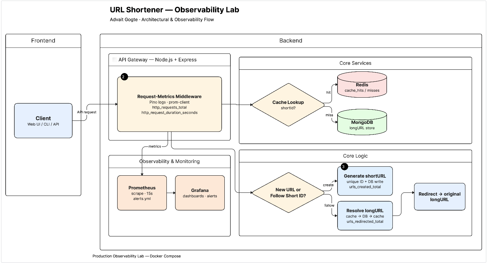
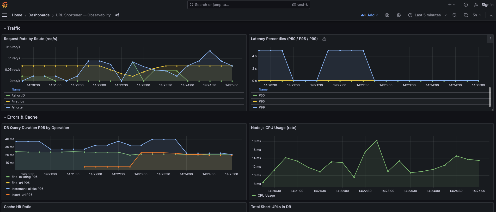

# Raccourcisseur d'URL — Laboratoire d'observabilité

##### Auteur : Advait Gogte

[English](./readme.md) | **Français**

[](https://github.com/agogte/urlshortener/actions/workflows/ci.yml)


Une API minimale de raccourcissement d'URL dont le véritable but est d'apprendre l'observabilité en production : métriques Prometheus, tableaux de bord Grafana, journalisation JSON structurée et seuils d'alerte compréhensibles.



## Stack technique

| Couche         | Technologie              |
| -------------- | ------------------------ |
| Frontend       | React 18 + Vite + Tailwind |
| API            | Node.js 20 + Express     |
| Base de données| MongoDB 7 (Mongoose)     |
| Cache          | Redis 7                  |
| Métriques      | Prometheus + prom-client |
| Tableaux de bord | Grafana 10             |
| Journalisation | Pino (JSON structuré)    |
| Exécution      | Docker Compose           |



## Démarrage rapide

```bash
docker compose up --build
```

| Service    | URL                   |
| ---------- | --------------------- |
| API        | http://localhost:3001 |
| Grafana    | http://localhost:3000 |
| Prometheus | http://localhost:9090 |

Le frontend se lance séparément avec Vite et redirige les appels API vers le port 3001 :

```bash
cd frontend && npm install && npm run dev   # http://localhost:5173
```

Grafana s'ouvre sans connexion (administrateur anonyme). Le tableau de bord **URL Shortener — Observability** est préconfiguré.

## API

### Raccourcir une URL

```bash
curl -X POST http://localhost:3001/shorten \
  -H 'Content-Type: application/json' \
  -d '{"url":"https://example.com/some/long/path"}'
# → {"shortID":"abc1234","shortUrl":"http://localhost:3001/abc1234"}
```

### Suivre une URL courte

```bash
curl -L http://localhost:3001/abc1234
```

Les redirections utilisent `302 Found` (temporaire) afin que chaque clic passe par le serveur et soit comptabilisé. Un `301` serait mis en cache par les navigateurs et fausserait les statistiques.

### Statistiques de clics

```bash
curl http://localhost:3001/api/stats/abc1234
```

### Vérification de santé

```bash
curl http://localhost:3001/health
```

### Métriques Prometheus brutes

```bash
curl http://localhost:3001/metrics
```

## Ce que vous pouvez observer

### Percentiles de latence

Le tableau de bord affiche les P50 / P95 / P99 pour toutes les routes. Envoyez des requêtes répétées et observez l'évolution de la distribution :

```bash
for i in $(seq 1 200); do curl -s http://localhost:3001/abc1234 > /dev/null; done
```

Le P95 est le chiffre sur lequel les ingénieurs d'astreinte sont alertés : il capture la latence de queue sans être faussé par les valeurs rares, contrairement au P99.

### Taux de réussite du cache

La première redirection d'un nouvel identifiant court est un échec de cache (recherche dans MongoDB). Chaque redirection suivante dans la limite du TTL d'une heure est un succès. Rejouez le même identifiant et regardez le ratio monter.

### Seuils d'alerte

Les alertes sont définies dans `prometheus/alerts.yml` :

| Alerte           | Condition                          | Gravité  |
| ---------------- | ---------------------------------- | -------- |
| HighP95Latency   | P95 > 500 ms pendant 2 min         | warning  |
| HighErrorRate    | taux de 5xx > 5 % pendant 1 min    | critical |
| LowCacheHitRatio | taux de succès < 50 % pendant 5 min| warning  |
| SlowDbQueries    | P95 BDD > 100 ms pendant 3 min     | warning  |

Consultez les alertes actives sur http://localhost:9090/alerts.

### Résilience de Redis

Chaque opération de cache a un délai d'expiration de 500 ms. Si Redis est lent ou indisponible, les requêtes se rabattent automatiquement sur MongoDB au lieu de rester bloquées :

```bash
docker compose pause redis
curl http://localhost:3001/<shortID>   # répond en ~500 ms via MongoDB
docker compose unpause redis
```

Les données du cache Redis ne persistent pas entre les redémarrages, par conception : c'est un cache de préchauffage, pas une source de vérité.

### Exercice MTTR

Provoquez une panne volontaire (mettez Redis en pause), observez le pic d'échecs de cache et l'augmentation de la latence, puis rétablissez le service et mesurez le temps nécessaire au tableau de bord pour revenir à la normale.

```bash
docker compose pause redis
# ... observer le tableau de bord ...
docker compose unpause redis
```

## Tests

```bash
cd backend && npm test
cd frontend && npm test
```

Une intégration continue GitHub Actions (`.github/workflows/ci.yml`) exécute les tests du backend et du frontend, le build du frontend et le build Docker à chaque pull request.

## Structure du projet

```
├── backend/
│   ├── src/
│   │   ├── server.js      # Application Express, routes, middleware de métriques
│   │   ├── db.js          # Connexion MongoDB + helper de requêtes instrumenté
│   │   ├── cache.js       # Client Redis + compteurs de succès/échecs
│   │   ├── metrics.js     # Définitions des métriques prom-client
│   │   ├── logger.js      # Logger JSON structuré Pino
│   │   └── models/
│   │       └── url.js     # Schéma Mongoose des URL courtes
│   ├── test/              # Tests unitaires node:test
│   ├── Dockerfile
│   └── package.json
├── frontend/              # Interface React + Vite + Tailwind
│   ├── src/
│   ├── public/
│   ├── index.html
│   └── vite.config.js     # Serveur de dev + proxy vers l'API
├── prometheus/
│   ├── prometheus.yml     # Configuration de scraping (intervalle de 15 s)
│   └── alerts.yml         # Règles d'alerte
├── grafana/
│   └── provisioning/
│       ├── datasources/   # Configure Prometheus comme source par défaut
│       └── dashboards/    # Charge automatiquement le JSON du tableau de bord
├── .github/workflows/
│   └── ci.yml             # Tests + builds à chaque pull request
├── docker-compose.yml
├── DESIGN.md              # Choix de conception et compromis
└── RUNBOOK.md             # Runbook de réponse aux incidents
```

## Métriques exposées

| Métrique                        | Type      | Labels                                |
| ------------------------------- | --------- | ------------------------------------- |
| `http_request_duration_seconds` | Histogram | method, route, status                 |
| `http_requests_total`           | Counter   | method, route, status                 |
| `cache_hits_total`              | Counter   | operation                             |
| `cache_misses_total`            | Counter   | operation                             |
| `db_query_duration_seconds`     | Histogram | operation                             |
| `urls_created_total`            | Counter   | —                                     |
| `urls_redirected_total`         | Counter   | —                                     |
| `active_short_urls`             | Gauge     | —                                     |
| `app_process_*`                 | (défaut)  | Tas Node.js, CPU, GC, boucle d'événements |
